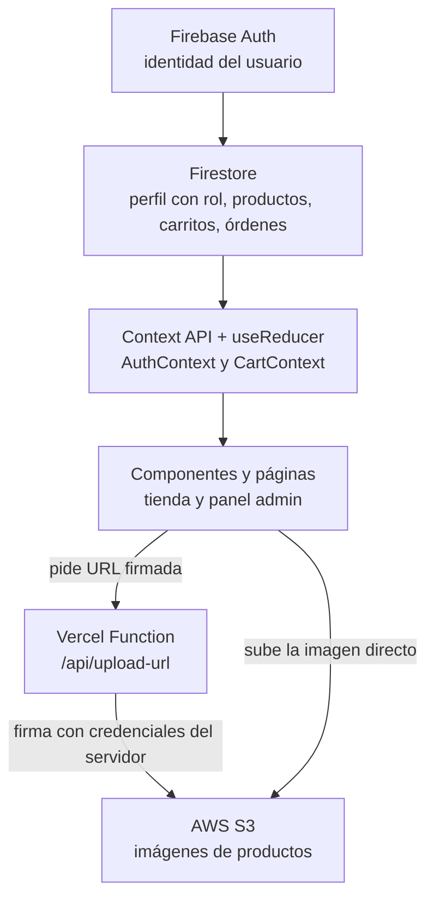
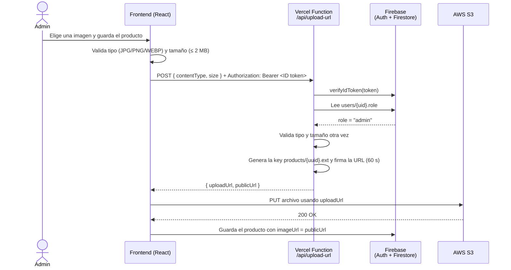

# 🏔️ Patagonix Store

E-commerce de equipamiento outdoor desarrollado como **Proyecto Integrador del Módulo 5 (Henry)**: una SPA con dos experiencias diferenciadas (cliente y administrador), autenticación con roles, carrito con Context + useReducer, checkout con órdenes en Firestore y subida segura de imágenes a AWS S3 mediante presigned URLs.

**🌐 Producción:** https://patagonix-store.vercel.app/

---

## 📑 Índice

1. [Contexto del cliente](#-contexto-del-cliente)
2. [Funcionalidades](#-funcionalidades)
3. [Stack tecnológico](#-stack-tecnológico)
4. [Arquitectura](#-arquitectura)
5. [Decisiones arquitectónicas](#-decisiones-arquitectónicas)
6. [Flujo de upload de imágenes a S3 con presigned URLs](#-flujo-de-upload-de-imágenes-a-s3-con-presigned-urls)
7. [Seguridad](#-seguridad)
8. [Instalación y configuración paso a paso](#-instalación-y-configuración-paso-a-paso)
9. [Variables de entorno](#-variables-de-entorno)
10. [Deploy en Vercel](#-deploy-en-vercel)
11. [Testing](#-testing)
12. [Bitácora de uso de IA](#-bitácora-de-uso-de-ia)
13. [Limitaciones conocidas y mejoras futuras](#-limitaciones-conocidas-y-mejoras-futuras)

---

## 🧭 Contexto del cliente

**Patagonix Tech** es una software factory que desarrolla aplicaciones web para el sector retail. Un cliente solicitó una plataforma de e-commerce **escalable, mantenible y basada en servicios administrados (BaaS)**, para reducir costos de infraestructura y acelerar el time-to-market.

La aplicación soporta dos tipos de usuarios:

- **Clientes**, que navegan el catálogo, arman su carrito y compran.
- **Administradores**, que gestionan el catálogo y las órdenes desde un panel protegido.

---

## ✨ Funcionalidades

### Cliente

- Registro e inicio de sesión con **email/contraseña** o **Google**, con persistencia de sesión.
- Catálogo en **tiempo real** con filtro por categoría y **búsqueda por nombre con debounce**.
- Detalle de producto con control de stock.
- **Carrito** con Context + useReducer: agregar, quitar, cambiar cantidades y total automático.
  - Visitante: el carrito se guarda en `localStorage`.
  - Con sesión: se sincroniza con Firestore por usuario, y al iniciar sesión se **fusiona** con el carrito armado como visitante.
- **Checkout** en dos pasos (revisión → envío y pago) con **pago simulado** y validación de formularios.
- **Historial de órdenes** y detalle de cada orden, con el estado actualizado en vivo.

### Administrador

- Panel con **layout propio** (barra lateral oscura en escritorio, pestañas deslizables en celular).
- **Dashboard de analytics** (crédito extra): métricas clave, gráfico de ventas de los últimos 14 días, órdenes por estado y ranking de productos más vendidos, todo en tiempo real.
- **CRUD de productos** con subida de imágenes a **AWS S3** y vista previa local.
- **Gestión de órdenes**: ver todas, filtrar por estado y cambiar el estado siguiendo un flujo permitido. Al cancelar, el stock se devuelve automáticamente.

### ⭐ Crédito extra: dashboard de analytics

El **Resumen** del panel admin muestra, en tiempo real (`onSnapshot`):

- **Métricas clave:** órdenes totales, pendientes, ingresos y ticket promedio.
- **Ventas de los últimos 14 días:** gráfico de barras con Recharts, con los días sin ventas en cero.
- **Órdenes por estado:** distribución de pendientes, en preparación, completadas y canceladas.
- **Productos más vendidos:** ranking por unidades, con sus ingresos.

Todos los cálculos viven en funciones puras (`src/utils/analytics.ts`), testeadas con una fecha fija. Las órdenes canceladas no cuentan como ventas. Recharts solo se descarga al entrar al panel admin, gracias al code splitting.

### UI / UX

- Diseño **mobile-first** y responsive.
- Skeletons y spinners en cada carga de datos.
- Mensajes claros cuando no hay productos, órdenes o ítems en el carrito.
- Errores comprensibles para el usuario (nunca códigos técnicos).
- Componentes reutilizables con props tipadas y accesibles (labels, roles ARIA, foco visible).

---

## 🛠️ Stack tecnológico

| Capa | Tecnologías |
|---|---|
| **Frontend** | React 18, TypeScript, Vite, React Router, TailwindCSS, Context API + useReducer, Recharts |
| **Backend / BaaS** | Firebase Authentication, Cloud Firestore |
| **Almacenamiento** | AWS S3 (presigned URLs) |
| **Serverless** | Vercel Serverless Functions + Firebase Admin SDK + AWS SDK v3 |
| **Testing** | Vitest, React Testing Library, user-event, cobertura con v8 |
| **Deploy** | Vercel (CI desde GitHub) |

---

## 🧱 Arquitectura

### Flujo general



### Estructura de carpetas (por capas técnicas)

```
├── api/                    → Vercel Serverless Functions (corren en el servidor)
│   ├── upload-url.ts       → genera presigned URLs para S3 (solo admins)
│   └── _tests/             → tests de la función (no se despliegan)
├── src/
│   ├── components/
│   │   ├── ui/             → componentes genéricos: Button, Input, Select, Alert, Spinner...
│   │   ├── layout/         → MainLayout, AdminLayout, Navbar
│   │   ├── routes/         → ProtectedRoute y AdminRoute
│   │   ├── products/       → tarjetas, grilla, filtros, agregar al carrito
│   │   ├── cart/           → fila del carrito
│   │   ├── orders/         → lista de ítems y badge de estado
│   │   └── admin/          → formulario de producto, subida de imagen, control de estados
│   ├── pages/              → una página por ruta (admin/ para el panel)
│   ├── contexts/           → AuthContext y CartContext, cada uno con su reducer
│   ├── hooks/              → useAuth, useCart, useProducts, useDebounce...
│   ├── services/           → ÚNICO lugar que habla con Firebase, la API o el pago
│   ├── types/              → interfaces del dominio (Product, CartItem, Order...)
│   ├── utils/              → funciones puras: validadores, formato, estados de orden
│   └── test/               → setup, wrapper de providers y tests de integración
├── firestore.rules         → reglas de seguridad versionadas
├── firestore.indexes.json  → índices compuestos de Firestore
└── vercel.json             → reescrituras para las rutas de la SPA
```

La regla principal: **los componentes describen qué se muestra; los servicios saben cómo se obtienen los datos.** Ningún componente importa Firebase directamente.

---

## 🧠 Decisiones arquitectónicas

### ¿Por qué Context API + useReducer (y no Redux o Zustand)?

- El estado global del proyecto es acotado y bien delimitado: **sesión** y **carrito**. Context + useReducer lo resuelve sin dependencias extra.
- El carrito tiene **muchas acciones** (agregar, quitar, cambiar cantidad, vaciar, fusionar) y **reglas compartidas** (no superar el stock, cantidad 0 = quitar). Con `useReducer` toda esa lógica vive en **una función pura**, fácil de leer y de testear (el reducer tiene 100% de cobertura).
- Los componentes solo despachan acciones (`ADD_ITEM`, `REMOVE_ITEM`...), sin saber cómo se actualiza el estado.
- **Contextos separados por responsabilidad**: `AuthContext` y `CartContext` tienen su propio reducer. El carrito *usa* la sesión para saber de quién es, pero no mezcla lógica.
- El total del carrito **no se guarda**: se calcula con un selector (`getCartTotal`), así nunca queda desincronizado.

### ¿Por qué tres estados de sesión?

El rol del usuario no lo provee Firebase Auth: se guarda en Firestore. Hay un instante en que Firebase ya sabe que hay usuario pero el rol todavía no llegó. Con solo dos estados (logueado / no logueado), una ruta de admin expulsaría a un administrador en ese instante. Por eso la sesión tiene tres estados: `loading`, `authenticated` y `unauthenticated`, y las rutas protegidas **esperan** mientras dura `loading`.

### ¿Por qué S3 con presigned URLs?

- Las credenciales de AWS **nunca llegan al navegador**: solo existen en la Vercel Function.
- El archivo viaja **directo del navegador a S3**, sin pasar por el servidor (más rápido y sin consumir el tiempo ni el límite de tamaño de la función).
- La URL firmada dura **60 segundos** y sirve para **un solo archivo**, con un nombre que decide el servidor.
- S3 separa el almacenamiento de archivos de la base de datos: en Firestore solo se guarda la URL.

### ¿Por qué estructura por capas técnicas?

Es la que pide el entregable (components, pages, contexts, services, hooks, types, api) y hace evidente la separación de responsabilidades. Para un proyecto mucho más grande, una estructura por features escalaría mejor, a costa de que la separación por responsabilidad sea menos visible.

### Otras decisiones

| Decisión | Motivo |
|---|---|
| **Transacciones de Firestore** al comprar y al cancelar | Evitan vender más stock del que hay si dos clientes compran a la vez, y devuelven el stock de forma atómica al cancelar |
| **El precio se toma de Firestore** al crear la orden | El carrito vive en el navegador y se puede manipular |
| **`onSnapshot`** en catálogo y órdenes | Los cambios del admin (precios, estados) se ven en vivo, sin recargar |
| **Flujo de estados de orden** en un solo lugar (`ORDER_TRANSITIONS`) | Lo usan la UI y el servicio, y se replica en las reglas de Firestore |
| **Búsqueda por prefijo** sobre `nameLower` | Firestore no tiene búsqueda de texto completo |
| **Debounce** en búsqueda y en el guardado del carrito | Una consulta cuando el usuario deja de tipear; una escritura aunque toque "+" varias veces |
| **Code splitting** con `React.lazy` | El panel admin no se descarga para los clientes; el código propio inicial bajó de 816 KB a 39 KB |

---

## 🔐 Flujo de upload de imágenes a S3 con presigned URLs



**Controles de la función, en orden:**

1. **Método:** solo `POST` (si no, `405`).
2. **Autenticación:** token de Firebase válido, verificado con el Admin SDK (si no, `401`).
3. **Autorización:** el rol se lee de Firestore **desde el servidor**; solo un admin obtiene URLs (si no, `403`).
4. **Validación:** solo JPG, PNG o WEBP, de hasta 2 MB (si no, `400`).
5. **Firma:** el nombre del archivo lo genera el servidor con `randomUUID()`, así el cliente no puede pisar otros archivos ni escribir fuera de `products/`.

**Configuración de AWS con mínimo privilegio:**

- El usuario IAM de la función solo tiene `s3:PutObject` sobre `products/*`. Si sus claves se filtraran, no podrían leer, borrar ni listar nada.
- El bucket permite **lectura pública solo de `products/*`** (para que las imágenes se vean en la tienda). No se puede listar el bucket ni escribir sin URL firmada.
- El CORS del bucket solo acepta `PUT` desde el dominio de producción y `localhost`.

---

## 🛡️ Seguridad

| Capa | Qué protege |
|---|---|
| **Variables de entorno** | `.env` en `.gitignore`; solo `.env.example` (sin valores) va al repo. Las credenciales de AWS y de Firebase Admin no llevan el prefijo `VITE_`, así que nunca llegan al navegador |
| **Rutas protegidas** | `ProtectedRoute` (requiere sesión) y `AdminRoute` (requiere rol admin), que esperan a que cargue el rol antes de decidir |
| **Reglas de Firestore** | Validan del lado del servidor lo que el frontend no puede garantizar (ver abajo) |
| **Vercel Function** | Verifica token, rol, tipo y tamaño antes de firmar |

**Reglas de Firestore destacadas** (`firestore.rules`):

- **Usuarios:** al registrarse, todo usuario es `customer`; nadie puede cambiar su propio rol. Los admins se asignan solo desde la consola de Firebase.
- **Productos:** lectura pública; escritura solo admin, con validación de tipos (precio > 0, stock entero ≥ 0, `nameLower` coincidente con el nombre).
- **Carritos:** cada usuario solo lee y escribe el suyo (`carts/{uid}`).
- **Órdenes:** el dueño ve las suyas y el admin todas; se crean solo a nombre propio, en estado `pending`, con pago aprobado y fecha del servidor; solo el admin cambia el estado, siguiendo el flujo permitido; **nunca se borran**.

---

## ⚙️ Instalación y configuración paso a paso

### Requisitos previos

- Node.js 20 o superior
- Cuenta de [Firebase](https://console.firebase.google.com), de [AWS](https://aws.amazon.com/free) y de [Vercel](https://vercel.com)
- Vercel CLI: `npm install -g vercel`

### 1. Clonar e instalar

```bash
git clone https://github.com/variasl9/Proyecto_M5Arias_Valentin.git
cd Proyecto_M5Arias_Valentin
npm install
cp .env.example .env
```

### 2. Firebase

1. Crear un proyecto en la consola de Firebase.
2. **Authentication → Método de inicio de sesión:** habilitar **Correo electrónico/contraseña** y **Google**.
3. **Firestore Database → Crear base de datos** en **modo de producción**.
4. **Firestore → Reglas:** pegar el contenido de `firestore.rules` y **Publicar**.
5. **Firestore → Índices → Compuesto:** crear los 4 índices definidos en `firestore.indexes.json`:

   | Colección | Campo 1 | Campo 2 |
   |---|---|---|
   | `products` | `category` ↑ | `createdAt` ↓ |
   | `products` | `category` ↑ | `nameLower` ↑ |
   | `orders` | `userId` ↑ | `createdAt` ↓ |
   | `orders` | `status` ↑ | `createdAt` ↓ |

6. **⚙️ Configuración del proyecto → Tus apps → Web (`</>`):** registrar la app y copiar los valores del `firebaseConfig` a las variables `VITE_FIREBASE_*` del `.env`.
7. **⚙️ Configuración del proyecto → Cuentas de servicio → Generar nueva clave privada:** del JSON descargado, copiar `project_id`, `client_email` y `private_key` a las variables `FIREBASE_*` del `.env`. **Nunca subir ese JSON al repositorio.**

### 3. AWS S3

1. **S3 → Crear bucket** (región `sa-east-1`), con **ACL deshabilitadas**. En el bloqueo de acceso público, dejar bloqueadas las opciones de **ACL** y desbloqueadas las de **políticas de bucket**.
2. **Permisos → Política de bucket** (lectura pública solo de `products/`):

   ```json
   {
     "Version": "2012-10-17",
     "Statement": [
       {
         "Sid": "PublicReadProductImages",
         "Effect": "Allow",
         "Principal": "*",
         "Action": "s3:GetObject",
         "Resource": "arn:aws:s3:::TU-BUCKET/products/*"
       }
     ]
   }
   ```

3. **Permisos → CORS:**

   ```json
   [
     {
       "AllowedHeaders": ["Content-Type"],
       "AllowedMethods": ["PUT"],
       "AllowedOrigins": ["https://TU-DOMINIO.vercel.app", "http://localhost:3000"],
       "ExposeHeaders": ["ETag"],
       "MaxAgeSeconds": 3000
     }
   ]
   ```

4. **IAM → Políticas → Crear política** (`patagonix-s3-upload`):

   ```json
   {
     "Version": "2012-10-17",
     "Statement": [
       {
         "Sid": "UploadProductImages",
         "Effect": "Allow",
         "Action": "s3:PutObject",
         "Resource": "arn:aws:s3:::TU-BUCKET/products/*"
       }
     ]
   }
   ```

5. **IAM → Usuarios → Crear usuario** sin acceso a la consola, con esa política adjunta. En **Credenciales de seguridad → Crear clave de acceso** (caso de uso: *aplicación que se ejecuta fuera de AWS*), copiar las claves a las variables `AWS_*` del `.env`.

### 4. Ejecutar en local

`npm run dev` levanta solo el frontend. Para que también funcione la Vercel Function (subida de imágenes), usar:

```bash
vercel link   # solo la primera vez
vercel dev    # http://localhost:3000
```

> **Windows:** si `vercel dev` falla con `EPERM ... symlink`, activar el **Modo de desarrollador** de Windows o ejecutar la terminal como administrador, y borrar la caché `%LOCALAPPDATA%\com.vercel.cli\Cache\builders-vlt`.

### 5. Crear un administrador

1. Registrarse normalmente en la app (el usuario queda como `customer`).
2. En **Firestore → Datos → `users` → tu documento**, cambiar `role` a `admin`.
3. Recargar la app: aparece el link **Admin**.

En desarrollo, el panel de **Resumen** tiene un botón para **cargar productos de ejemplo** (no aparece en producción).

---

## 🔑 Variables de entorno

El archivo `.env.example` tiene todos los nombres, sin valores.

| Variable | Dónde se usa | Descripción |
|---|---|---|
| `VITE_FIREBASE_API_KEY` | Frontend | Config pública de Firebase |
| `VITE_FIREBASE_AUTH_DOMAIN` | Frontend | Config pública de Firebase |
| `VITE_FIREBASE_PROJECT_ID` | Frontend | Config pública de Firebase |
| `VITE_FIREBASE_STORAGE_BUCKET` | Frontend | Config pública de Firebase |
| `VITE_FIREBASE_MESSAGING_SENDER_ID` | Frontend | Config pública de Firebase |
| `VITE_FIREBASE_APP_ID` | Frontend | Config pública de Firebase |
| `AWS_ACCESS_KEY_ID` | Vercel Function | Clave del usuario IAM (solo `PutObject`) |
| `AWS_SECRET_ACCESS_KEY` | Vercel Function | **Secreta.** Nunca en el frontend |
| `AWS_REGION` | Vercel Function | Ej.: `sa-east-1` |
| `AWS_S3_BUCKET` | Vercel Function | Nombre del bucket |
| `FIREBASE_PROJECT_ID` | Vercel Function | Firebase Admin SDK |
| `FIREBASE_CLIENT_EMAIL` | Vercel Function | Firebase Admin SDK |
| `FIREBASE_PRIVATE_KEY` | Vercel Function | **Secreta.** En una línea, con los `\n` como texto |

> Las variables `VITE_` se incrustan en el JavaScript **al compilar**: la config de Firebase es pública por diseño (la seguridad real la dan Authentication y las reglas de Firestore). Las demás se leen solo en el servidor.

---

## 🚀 Deploy en Vercel

1. **Vercel → proyecto → Settings → Git:** conectar el repositorio de GitHub. Cada push a `main` despliega automáticamente.
2. **Settings → Environment Variables:** cargar las 13 variables para Production, Preview y Development (se puede pegar el `.env` completo en el campo *Key*). `FIREBASE_PRIVATE_KEY` va **sin** comillas.
3. **Deployments → Redeploy** (las variables `VITE_` requieren un build nuevo).
4. **Firebase → Authentication → Configuración → Dominios autorizados:** agregar el dominio de Vercel (sin `https://`). Sin esto falla el login con Google.
5. **S3 → CORS:** agregar `https://TU-DOMINIO.vercel.app`. Sin esto falla la subida de imágenes.

`vercel.json` reescribe a `index.html` todas las rutas sin extensión que no sean de la API, para que React Router funcione al recargar cualquier página.

---

## 🧪 Testing

```bash
npm run test            # corre todos los tests
npm run test:watch      # modo observación
npm run test:coverage   # cobertura (reporte en coverage/index.html)
```

**Más de 110 tests en 12 archivos**, deterministas y sin conexiones reales: Firebase, Firestore, el pago, `fetch` y el AWS SDK están mockeados.

| Tipo | Qué se testea |
|---|---|
| **Reducers** | `cartReducer` (cada acción, límites de stock, inmutabilidad con `Object.freeze`, fusión de carritos) y `authReducer` |
| **Hooks con `renderHook`** | `useCart` (persistencia local, fusión con la nube, debounce del guardado) y `useAuth` (estado intermedio de carga del rol, errores, desuscripción) |
| **Rutas protegidas** | Spinner sin redirección mientras carga el rol; redirección de visitantes al login y de customers al catálogo |
| **Servicios** | Pago simulado (con timers falsos) y subida a S3 (con `fetch` mockeado) |
| **Integración** | Flujo completo de compra sobre la `App` real: detalle → carrito → checkout → orden, más pago rechazado, formulario incompleto y falta de stock |
| **Vercel Function** | Los 4 controles de seguridad con el AWS SDK y Firebase Admin mockeados |
| **Lógica pura** | Validadores de formularios (con fecha fija), transiciones de estado de órdenes y cálculos del dashboard de analytics |

**Wrapper de providers:** `src/test/test-utils.tsx` exporta `renderWithProviders`, que envuelve los componentes en `MemoryRouter`, `AuthContext` (con un estado de sesión fabricado a medida) y el `CartProvider` real.

**Criterio de cobertura:** se priorizó lo que más le costaría romper a la aplicación. Reducers, hooks de estado, rutas protegidas y validadores están entre 90% y 100%; el checkout, 92%; la Vercel Function, 90%. Los servicios que solo envuelven Firestore no se testean de forma unitaria, porque con Firestore mockeado se estaría testeando el mock.

---

## 🤖 Bitácora de uso de IA

Durante el desarrollo usé **Claude** como asistente para planificar la arquitectura, validar decisiones técnicas, depurar errores y generar casos de test. Estos son los momentos clave:

| # | Etapa | Pregunta o prompt | Qué aprendí | Decisión resultante |
|---|---|---|---|---|
| 1 | Setup y arquitectura | *"¿Conviene organizar un e-commerce con Context + Firestore por capas técnicas o por features? Justificá para un proyecto mediano con 2 roles."* | Las dos son válidas: por capas hace visible la separación de responsabilidades; por features escala mejor en proyectos grandes. | Usé capas técnicas, porque coincide con el entregable y es más fácil de recorrer y defender en un proyecto de este tamaño. |
| 2 | Autenticación | *"Si el rol del usuario se guarda en Firestore y no en Firebase Auth, ¿cómo evito que una ruta de admin redirija al usuario antes de que el rol termine de cargar?"* | `onAuthStateChanged` avisa que hay usuario antes de que el rol esté disponible. Con solo dos estados, un admin parece no serlo durante un instante. | Modelé la sesión con tres estados (`loading`, `authenticated`, `unauthenticated`) en un reducer, y las rutas protegidas esperan mientras dura `loading`. Lo verifiqué con un test que congela ese instante. |
| 3 | Autenticación | *"Al registrar un usuario con Firebase, ¿cómo evito que onAuthStateChanged y la función de registro creen el perfil en Firestore dos veces?"* | Es una condición de carrera: el listener se dispara mientras el registro todavía está en curso. | Usé `runTransaction` para crear el perfil de forma atómica en lugar de un `getDoc` + `setDoc`. |
| 4 | Carrito | *"¿Por qué usar useReducer en lugar de useState para un carrito? Y si un visitante arma un carrito y después inicia sesión, ¿cómo evito perderlo o pisar el guardado en Firestore?"* | Con varias acciones y reglas compartidas, el reducer concentra la lógica en una función pura. Y si se guarda en la nube antes de terminar de leerla, se pisa el carrito guardado con uno vacío. | Reducer con 5 acciones y el total como selector. No escribo en Firestore hasta haber leído el carrito remoto, fusiono ambos y agrupo las escrituras con un debounce de 500 ms. |
| 5 | Checkout | *"Si dos clientes compran la última unidad al mismo tiempo, ¿cómo evito vender más stock del que hay con Firestore?"* | Sin transacción, ambos leen el mismo stock antes de que el otro escriba. `runTransaction` lee, valida y escribe de forma atómica, y reintenta si los datos cambiaron. | La orden se crea y el stock se descuenta en la misma transacción, tomando el **precio real** de Firestore y no el del carrito. |
| 6 | Seguridad | *"¿Qué riesgos de seguridad tiene crear órdenes y descontar stock directamente desde el navegador con Firestore?"* | Las reglas limitan mucho (orden a nombre propio, estado inicial `pending`, solo bajar stock), pero no pueden verificar que el total coincida con los ítems, ni impedir que un usuario logueado baje stock sin comprar. | Mantuve la solución con reglas estrictas para el alcance del proyecto, y lo documenté como limitación: en producción real, la orden se crearía en el servidor con el Admin SDK, como ya hago con S3. |
| 7 | Panel admin / S3 | *"Si la Vercel Function que genera presigned URLs es pública, ¿qué impide que cualquiera la use para subir archivos a mi bucket?"* | La presigned URL protege las **credenciales**, pero no decide **quién** puede pedirla. | La función verifica el token con el Admin SDK, lee el rol en Firestore desde el servidor, valida tipo y tamaño y genera el nombre del archivo. Además, el usuario IAM solo tiene `PutObject` sobre `products/*`. |
| 8 | Testing | *"Te paso mi cartReducer y mi función de upload. ¿Qué casos edge debería testear que no se me ocurrieron?"* | Surgieron casos que no había considerado: cantidades negativas, stock 0, fusión de carritos que supera el stock, verificar inmutabilidad con `Object.freeze`, y un `contentType` como `'toString'`, que engañaría a un objeto común de JavaScript. | Incorporé esos casos. El de `'toString'` confirmó que usar un `Map` en la función era la decisión correcta. |
| 9 | Deploy | *"Vite me avisa que el bundle pesa más de 500 KB. ¿Cómo lo reduzco en una SPA con Firebase?"* | Code splitting por rutas con `React.lazy` y separación de librerías en archivos propios, para aprovechar la caché del navegador. | Lazy loading del panel admin y páginas secundarias (no del checkout, para no agregar un spinner antes de pagar). El código propio inicial bajó de 816 KB a 39 KB, sin subir el límite del aviso. |
| 10 | Deploy | *"Después de agregar vercel.json, vercel dev falla con 'Failed to parse source' en index.html."* | La regla de reescritura de la SPA también capturaba los pedidos internos de Vite, que recibían HTML en vez de JavaScript. El error apuntaba al archivo equivocado. | Acoté la regla a rutas sin punto que no empiecen con `api/` ni `@`. |
| 11 | Crédito extra | *"Quiero un dashboard de ventas con las órdenes de Firestore. ¿Dónde conviene calcular las métricas y cómo las testeo?"* | Si los cálculos viven dentro del componente, quedan mezclados con la UI y son difíciles de testear. Además, un gráfico por día tiene que mostrar los días **sin** ventas, o el eje engaña. | Separé los cálculos en funciones puras (`analytics.ts`) que reciben la fecha como parámetro, completé los días vacíos con cero, excluí las órdenes canceladas y usé `useMemo` para no recalcular en cada render. |

**Reflexión general:** la IA me resultó más útil para **cuestionar decisiones** y encontrar problemas que no veía (condiciones de carrera, estados intermedios, límites de seguridad) que para generar código. Los mejores resultados vinieron de explicarle el contexto concreto y pedirle alternativas con sus ventajas y desventajas, para después elegir con criterio propio. También aprendí que hay que verificar cada propuesta: varias veces la causa real de un error estaba en la configuración del entorno (reglas sin publicar, permisos de Windows, el `vercel.json`) y no en el código.

---

## 🚧 Limitaciones conocidas y mejoras futuras

- **Búsqueda por prefijo:** "andes" no encuentra "Campera Andes Pro". Para búsqueda completa haría falta un servicio como Algolia o Typesense.
- **Creación de órdenes desde el cliente:** está protegida por reglas, pero lo ideal sería moverla a una función del servidor con el Admin SDK.
- **Imágenes huérfanas:** al eliminar un producto, su imagen queda en S3. Borrarla requeriría otra función con `s3:DeleteObject`; se dejó fuera para mantener el usuario IAM con el mínimo privilegio.
- **Analytics calculados en el navegador:** con muchas órdenes convendría precalcular las métricas en el servidor (por ejemplo, con un documento de totales que se actualice al crear cada orden).
- **Mejoras posibles:** paginación del catálogo con `limit()` y `startAfter()`, y reviews y ratings.

---

## 👤 Autor

**Valentín Arias** · Proyecto Integrador M5 · [Henry](https://www.soyhenry.com)
